# Apache Kafka --- Beginner to Advanced Guide

### Easy explanations • Graphic diagrams • Node.js examples • Real-world scenarios • Interview preparation

> **Goal:** Understand Kafka from zero to production-level concepts.
> Read the chapters in order, run the examples, and complete the
> exercises at the end.
>
> **Tech stack for examples:** Node.js + TypeScript-friendly
> JavaScript + KafkaJS. The same concepts apply to Java, Python, Go, and
> other Kafka clients.

------------------------------------------------------------------------

## Learning roadmap

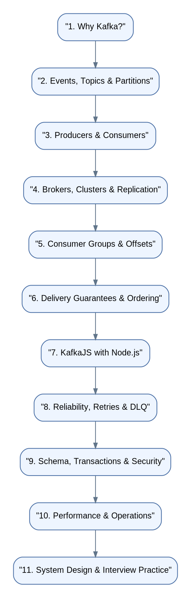

*Editable diagram source: `image/diagram_01.mmd` · Scalable version: `image/diagram_01.svg`*

## 1. What is Apache Kafka?

**Simple definition:** Apache Kafka is a distributed event-streaming
platform. Applications publish events to Kafka, and other applications
read those events independently.

Imagine an online store. When a customer places an order, several things
may need to happen:

-   Save the order.
-   Charge the customer.
-   Reduce inventory.
-   Send an email.
-   Update analytics.

A tightly coupled application might call all these services one after
another. If the email service is down, the order flow may become slow or
fail. Kafka allows the order service to publish an `OrderCreated` event
once; separate consumers process it for their own purposes.

### Without Kafka vs. with Kafka

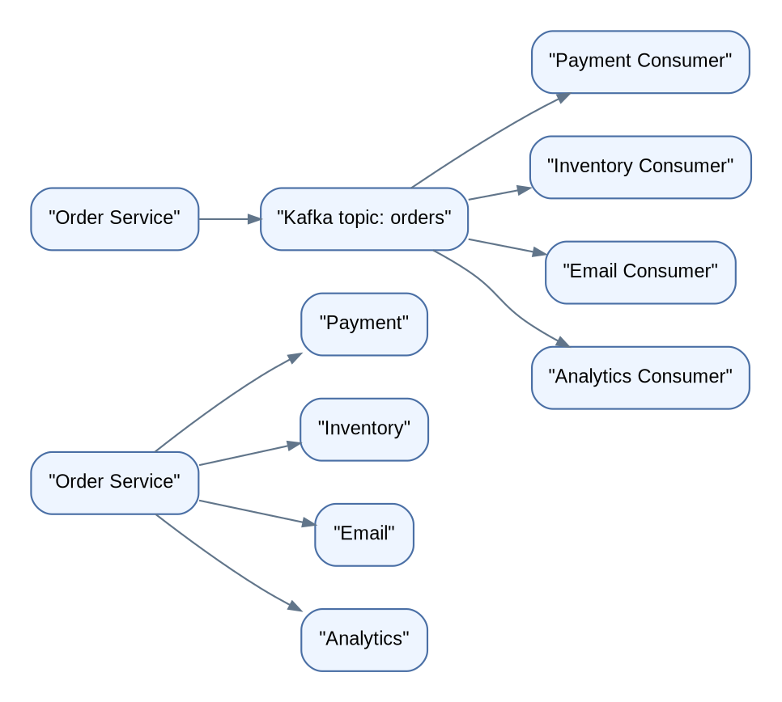

*Editable diagram source: `image/diagram_02.mmd` · Scalable version: `image/diagram_02.svg`*

**Why teams use Kafka** - **Decoupling:** Producers do not need to know
every consumer. - **Buffering:** Events can wait in Kafka while a
consumer is temporarily unavailable. - **Replay:** Consumers can re-read
retained events. - **Scale:** Add partitions and consumer instances to
increase parallelism. - **Durability:** Events can be written to disk
and replicated across brokers. - **Streaming:** Process a continuous
flow of data in near real time.

**Kafka is not automatically the right tool.** A simple request/response
API, a small background task, or a job that needs complex per-message
scheduling may be better served by HTTP, a database queue, or another
messaging system.

------------------------------------------------------------------------

## 2. What is an event?

An **event** is a record that says something happened. It commonly
contains:

-   **Key:** Which entity the event relates to, such as `order-1001`.
-   **Value:** The event data, usually JSON, Avro, Protobuf, or another
    serialized format.
-   **Timestamp:** When the event was created or recorded.
-   **Headers:** Optional metadata such as trace ID or event version.

Example event:

``` json
{
  "eventId": "evt-901",
  "eventType": "OrderCreated",
  "orderId": "order-1001",
  "customerId": "customer-42",
  "total": 1499,
  "currency": "INR",
  "occurredAt": "2026-10-20T08:00:00Z"
}
```

**Event vs. command** - `OrderCreated` is a fact: something already
happened. - `CreateOrder` is a command: someone is asking for an action.

**Event vs. message:** In everyday conversation these words overlap. In
event-driven design, an event usually describes a fact that consumers
can independently react to.

------------------------------------------------------------------------

## 3. Kafka architecture: the main building blocks

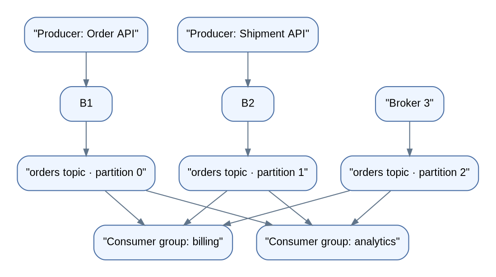

*Editable diagram source: `image/diagram_03.mmd` · Scalable version: `image/diagram_03.svg`*

### Terms to remember

  -----------------------------------------------------------------------
  Term                    Easy meaning            Analogy
  ----------------------- ----------------------- -----------------------
  Producer                Writes events to Kafka  Person posting a letter

  Consumer                Reads/processes events  Person receiving a
                                                  letter

  Topic                   Named stream of events  A named news feed

  Partition               Ordered slice of a      One lane of a
                          topic                   multi-lane road

  Broker                  Kafka server            One branch of a storage
                                                  network

  Cluster                 Multiple brokers        The whole network
                          working together        

  Offset                  Position of a record in A bookmark
                          one partition           

  Consumer group          Consumers sharing the   A team splitting a
                          work                    queue

  Replication             Copies of partition     Backup copies
                          data                    

  Retention               How long Kafka keeps    Archive policy
                          records                 
  -----------------------------------------------------------------------

------------------------------------------------------------------------

## 4. Topics, partitions, records, and offsets

A **topic** is a named stream, such as `orders`, `payments`, or
`shipments`. A topic is split into **partitions** so Kafka can store and
process data in parallel.

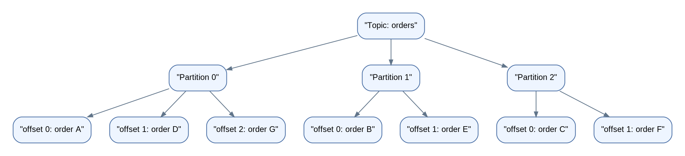

*Editable diagram source: `image/diagram_04.mmd` · Scalable version: `image/diagram_04.svg`*

### Important rules

1.  Offsets are **per partition**, not global to the whole topic.
2.  Kafka guarantees record order **within a partition**, not across all
    partitions.
3.  More partitions can provide more consumer parallelism, but also add
    operational overhead.
4.  A record's key can influence which partition receives it.
5.  Adding partitions later can change key-to-partition mapping for
    future records, depending on the partitioning strategy.

### Why keys matter

If you publish events with key `order-1001`, Kafka's default keyed
partitioning generally sends that key to the same partition. This helps
keep events for one order in order.

``` js
await producer.send({
  topic: "orders",
  messages: [
    { key: "order-1001", value: JSON.stringify({ status: "CREATED" }) },
    { key: "order-1001", value: JSON.stringify({ status: "PAID" }) },
    { key: "order-1001", value: JSON.stringify({ status: "SHIPPED" }) }
  ]
});
```

**Common mistake:** Using a random key for events that must be ordered
by customer or order can spread related events across partitions.

------------------------------------------------------------------------

## 5. Producers: how data enters Kafka

A producer creates records and sends them to a topic. It can choose a
key, include headers, and configure reliability behavior.

Typical path:

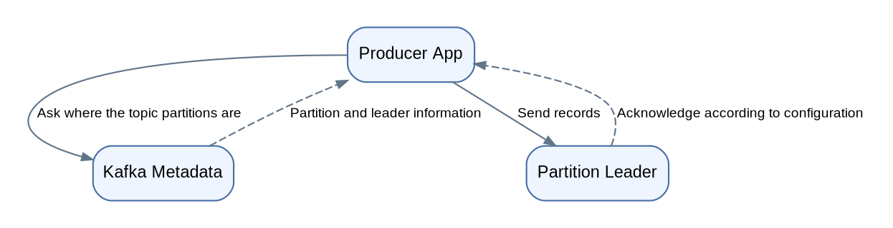

*Editable diagram source: `image/diagram_05.mmd` · Scalable version: `image/diagram_05.svg`*

### Producer concepts

-   **Serialization:** Converts an object into bytes for transport.
-   **Partitioner:** Chooses the target partition.
-   **Batching:** Sends records together to reduce network overhead.
-   **Compression:** Reduces bytes sent and stored.
-   **Acknowledgements (`acks`):** Controls when the producer considers
    a write successful.
-   **Retries:** Re-attempts eligible failed requests.
-   **Idempotent producer:** Helps prevent duplicate writes caused by
    producer retries under supported conditions.

A successful producer acknowledgement means the broker accepted the
write according to the selected acknowledgement policy. It does **not**
mean every downstream business operation has completed.

------------------------------------------------------------------------

## 6. Consumers and consumer groups

A consumer subscribes to topics and processes records. A **consumer
group** lets multiple consumer instances share partitions.

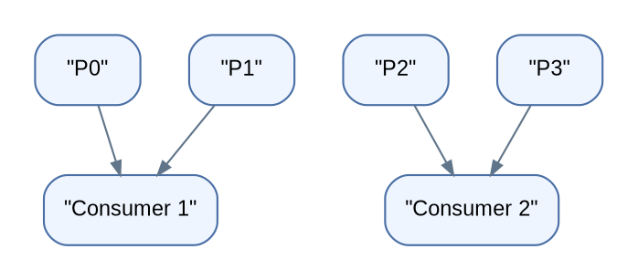

*Editable diagram source: `image/diagram_06.mmd` · Scalable version: `image/diagram_06.svg`*

Within one consumer group, a partition is assigned to at most one
consumer at a time. Therefore:

-   Four partitions can support up to four active consumers in the
    group.
-   If you run six consumers for four partitions, at least two consumers
    will be idle for that topic.
-   Two different consumer groups can each read the same topic
    independently.

### Multiple groups are independent subscribers

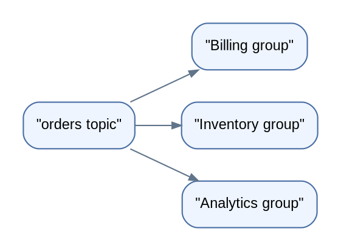

*Editable diagram source: `image/diagram_07.mmd` · Scalable version: `image/diagram_07.svg`*

Billing can be at offset 500 while analytics is at offset 420. Each
group tracks its own progress.

### Rebalancing

When consumers join, leave, crash, or partition assignments change,
Kafka may redistribute partitions among the group. This is called a
**rebalance**.

Rebalances are normal, but frequent rebalances can reduce throughput.
Avoid unnecessarily long processing in the poll/heartbeat path, manage
deployments carefully, and understand your client's timeout settings.

------------------------------------------------------------------------

## 7. Offsets: bookmarks for progress

An offset is a record's position inside a partition. A consumer group
commits offsets to record its progress.

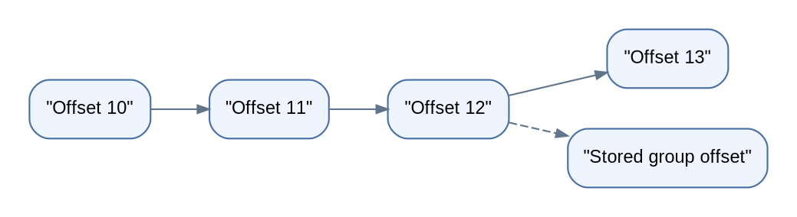

*Editable diagram source: `image/diagram_08.mmd` · Scalable version: `image/diagram_08.svg`*

In many clients, the committed offset represents the **next position to
read**, not simply "the last record processed." Check the client API
semantics.

### Auto-commit vs. manual commit

-   **Auto-commit:** Easier, but the committed position may move ahead
    of completed business work in some processing patterns.
-   **Manual commit:** More control. Commit only after the processing
    step you want to treat as complete.
-   **Never assume exactly-once business effects from offset commits
    alone.** A process can update a database and crash before
    committing, causing the record to be processed again.

### The classic failure window

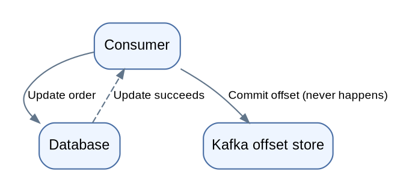

*Editable diagram source: `image/diagram_09.mmd` · Scalable version: `image/diagram_09.svg`*

Design consumers to handle duplicates safely. This is called
**idempotent processing**.

------------------------------------------------------------------------

## 8. Delivery semantics: at-most-once, at-least-once, exactly-once

  -----------------------------------------------------------------------
  Semantics               Meaning                 Main trade-off
  ----------------------- ----------------------- -----------------------
  At-most-once            A record is processed   Can lose work if
                          zero or one time        progress is committed
                                                  too early

  At-least-once           A record may be         Requires duplicate-safe
                          processed more than     processing
                          once                    

  Exactly-once            Certain Kafka           Requires specific
                          read-process-write      configuration and
                          workflows can be atomic design; not a universal
                                                  promise for external
                                                  side effects
  -----------------------------------------------------------------------

### Practical example

Suppose a consumer charges a credit card:

-   Retrying blindly can charge the customer twice.
-   Skipping retries can lose a charge.
-   Use the payment provider's **idempotency key** (for example, the
    order/payment ID), persist processing state, and reconcile outcomes.

Kafka's exactly-once processing features are useful for Kafka-to-Kafka
workflows. They do not automatically make an external database update,
email, or payment exactly once.

------------------------------------------------------------------------

## 9. Replication, leaders, followers, and ISR

Kafka replicates partitions across brokers for fault tolerance.

-   **Leader replica:** Handles reads/writes for that partition under
    normal operation.
-   **Follower replica:** Replicates the leader's log.
-   **ISR (In-Sync Replicas):** Replicas considered sufficiently caught
    up under Kafka's replication rules.
-   **Replication factor:** Number of replicas for each partition.

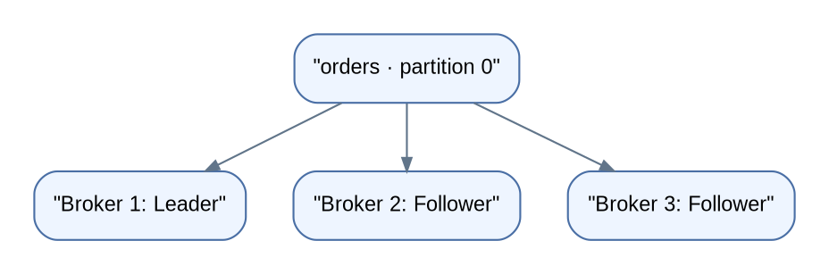

*Editable diagram source: `image/diagram_10.mmd` · Scalable version: `image/diagram_10.svg`*

For production topics, a common starting point is replication factor 3,
where infrastructure and cost permit. The appropriate setting depends on
availability, durability, and cluster size.

### `acks` in simple terms

-   `acks=0`: Producer does not wait for broker acknowledgement; weakest
    confirmation.
-   `acks=1`: Leader acknowledges the write.
-   `acks=all` (or `-1`): Waits for acknowledgement from the required
    in-sync replicas according to the topic/broker configuration.

`acks=all` plus an appropriate `min.insync.replicas` can improve
durability, but it may reject writes when too few replicas are in sync.
This is a deliberate availability-vs-durability trade-off.

**Replication factor is not the same as number of consumers.** Replicas
protect stored data; consumers process data.

------------------------------------------------------------------------

## 10. Retention, log compaction, and deleting data

Kafka is a log, not simply a queue that deletes a message as soon as one
consumer reads it.

### Time/size retention

Kafka retains records according to configured time and/or size policies.
A record may be removed after retention expires, even if a slow consumer
has not read it.

### Log compaction

Compaction keeps the latest value for each key (subject to the
compaction process and tombstone rules). It is useful for a topic that
represents the latest known state of entities.

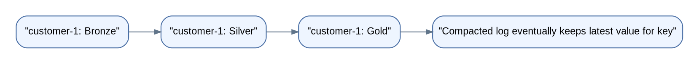

*Editable diagram source: `image/diagram_11.mmd` · Scalable version: `image/diagram_11.svg`*

-   **Retention:** "Keep events for a period/size."
-   **Compaction:** "Preserve the latest state per key."
-   **Tombstone:** A keyed record with a null value that signals
    deletion in a compacted topic.

Do not assume compaction instantly removes every older record; it runs
asynchronously.

------------------------------------------------------------------------

## 11. Kafka vs. RabbitMQ vs. REST

  -----------------------------------------------------------------------
  Situation                           Often a good fit
  ----------------------------------- -----------------------------------
  Request needs an immediate response REST/gRPC

  Many independent consumers need the Kafka
  same event history                  

  Traditional task queue with         RabbitMQ
  flexible routing/acknowledgement    
  patterns                            

  Large event streams, replay,        Kafka
  analytics pipelines                 

  Simple service-to-service query     REST/gRPC

  Complex per-message delay and       A task queue may fit better
  routing requirements                
  -----------------------------------------------------------------------

These are guidelines, not absolute rules. Kafka can be used for work
distribution, and RabbitMQ can support many sophisticated messaging
designs.

------------------------------------------------------------------------

## 12. Build a local Kafka environment

For a real project, use the official Apache Kafka documentation and
current Docker image guidance. A local development setup is useful for
learning, but should not be treated as a production deployment recipe.

Minimum steps: 1. Install a current Node.js LTS release. 2. Start a
local Kafka broker using the official Kafka quickstart or a maintained
local container setup. 3. Create a topic named `orders`. 4. Run one
producer and one consumer. 5. Stop the consumer, publish more events,
then restart it and observe its offsets and replay behavior.

Official documentation: https://kafka.apache.org/documentation/

------------------------------------------------------------------------

## 13. Node.js implementation with KafkaJS

Install the client:

``` bash
npm init -y
npm install kafkajs
```

Create a file named `producer.js`:

``` js
const { Kafka } = require("kafkajs");

const kafka = new Kafka({
  clientId: "orders-api",
  brokers: ["localhost:9092"]
});

const producer = kafka.producer();

async function main() {
  await producer.connect();

  const event = {
    eventId: crypto.randomUUID(),
    eventType: "OrderCreated",
    orderId: "order-1001",
    total: 1499,
    occurredAt: new Date().toISOString()
  };

  await producer.send({
    topic: "orders",
    messages: [
      {
        key: event.orderId,
        value: JSON.stringify(event),
        headers: { "event-type": "OrderCreated" }
      }
    ]
  });

  console.log("Published:", event);
  await producer.disconnect();
}

main().catch((error) => {
  console.error(error);
  process.exitCode = 1;
});
```

> **Note:** In Node.js versions that do not expose `crypto.randomUUID()`
> globally, add `const { randomUUID } = require("node:crypto")` and use
> `randomUUID()`.

Create `consumer.js`:

``` js
const { Kafka } = require("kafkajs");

const kafka = new Kafka({
  clientId: "orders-worker",
  brokers: ["localhost:9092"]
});

const consumer = kafka.consumer({ groupId: "order-notifications" });

async function main() {
  await consumer.connect();

  await consumer.subscribe({
    topic: "orders",
    fromBeginning: true
  });

  await consumer.run({
    eachMessage: async ({ topic, partition, message }) => {
      const raw = message.value?.toString();
      if (!raw) return;

      const event = JSON.parse(raw);

      console.log({
        topic,
        partition,
        offset: message.offset,
        event
      });

      // In a real service, validate the event and perform an idempotent action.
    }
  });
}

main().catch((error) => {
  console.error(error);
  process.exitCode = 1;
});

async function shutdown() {
  await consumer.disconnect();
  process.exit(0);
}

process.on("SIGINT", shutdown);
process.on("SIGTERM", shutdown);
```

Run them in separate terminals:

``` bash
node consumer.js
node producer.js
```

**Important:** `fromBeginning: true` does not necessarily mean every
restart replays all records. It is used when the group has no valid
committed offset; existing committed offsets normally take precedence.
Use a new group ID or explicitly reset offsets when practicing replay.

### Production improvements to make next

-   Validate event shape before processing.
-   Handle malformed messages and route them to a dead-letter topic
    (DLQ) when appropriate.
-   Make database writes idempotent.
-   Add structured logs, metrics, and trace/correlation IDs.
-   Configure TLS/SASL authentication where required.
-   Handle shutdown gracefully.
-   Tune batching, compression, fetch sizes, and concurrency only after
    measuring.
-   Keep credentials in a secret manager or environment configuration,
    not source code.

------------------------------------------------------------------------

## 14. Retries, dead-letter topics, and poison messages

A **transient error** may succeed later, such as a brief network issue.
A **permanent error** may never succeed without a code/data fix, such as
an invalid event schema.

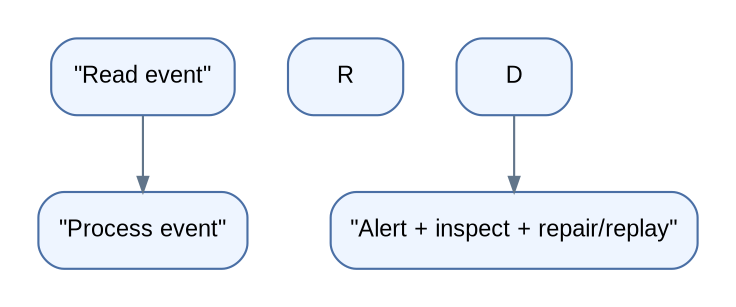

*Editable diagram source: `image/diagram_12.mmd` · Scalable version: `image/diagram_12.svg`*

Good retry design: 1. Classify failures rather than retrying everything.
2. Use bounded retries and backoff. 3. Avoid blocking a partition
forever on one poison message. 4. Preserve original event, error reason,
and correlation ID in the DLQ. 5. Alert on DLQ growth and define a safe
replay procedure.

A DLQ is not a garbage bin. It needs ownership, monitoring, retention,
and a process for remediation.

------------------------------------------------------------------------

## 15. Schema evolution and Schema Registry

Producers and consumers often deploy at different times. A schema
strategy helps prevent one service's change from breaking another.

Example evolution: - Version 1:
`{ "orderId": "order-1", "total": 100 }` - Version 2:
`{ "orderId": "order-1", "total": 100, "currency": "INR" }`

Safer changes usually include adding optional fields with sensible
defaults and making consumers tolerate unknown fields. Removing or
changing the meaning/type of an existing field can be breaking.

Common formats: - **JSON:** Easy to read, but schema discipline is up to
your tooling. - **Avro:** Common in Kafka ecosystems; compact binary
format and schema evolution support. - **Protocol Buffers:** Strongly
typed schema and efficient serialization.

A **Schema Registry** stores schemas and checks compatibility according
to configured rules. Compatibility modes differ, so choose one based on
rollout and replay requirements rather than assuming one mode fits all.

------------------------------------------------------------------------

## 16. Kafka transactions and exactly-once processing

Transactions can atomically write records to multiple Kafka partitions
and coordinate consumed offsets with produced records in supported
consume-transform-produce workflows.

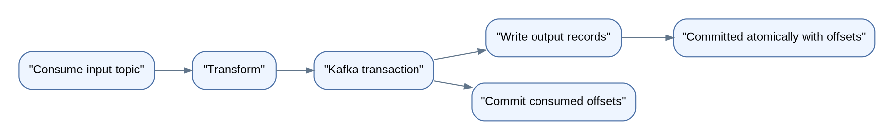

*Editable diagram source: `image/diagram_13.mmd` · Scalable version: `image/diagram_13.svg`*

Key terms: - `transactional.id`: Identifies a transactional producer
across restarts; configure it carefully. - `read_committed`: Consumers
read only committed transactional records. - **Atomicity:** Output
records and consumed offsets can be committed together in supported
Kafka workflows.

Transactions do not make an email or payment API call part of the Kafka
transaction. For external systems, use idempotency, an outbox/inbox
pattern, or reconciliation.

------------------------------------------------------------------------

## 17. The transactional outbox pattern

Problem: A service updates a database and publishes an event. If the
database commit succeeds but Kafka publish fails, the systems disagree.

The **outbox pattern** writes the business change and an outbox event in
the same database transaction. A separate publisher forwards outbox rows
to Kafka and marks them as published (or uses CDC).

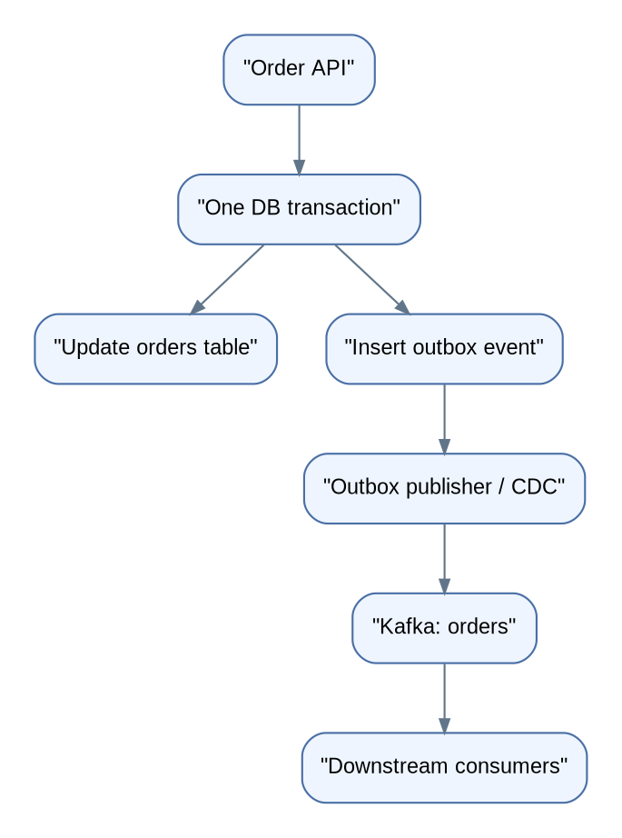

*Editable diagram source: `image/diagram_14.mmd` · Scalable version: `image/diagram_14.svg`*

This avoids the unsafe assumption that a database transaction and Kafka
publish automatically succeed together. The publisher may send an event
more than once, so consumers should still be idempotent.

------------------------------------------------------------------------

## 18. Kafka Connect and stream processing

### Kafka Connect

A framework for moving data between Kafka and external systems using
connectors. Examples include databases, object storage, search systems,
and data warehouses.

-   **Source connector:** External system → Kafka.
-   **Sink connector:** Kafka → external system.
-   **CDC (Change Data Capture):** Captures database changes and
    publishes them as events, often through a connector such as
    Debezium.

### Kafka Streams

A Java library for building stream-processing applications, such as
filtering, joining, aggregating, and windowing event streams.

### ksqlDB

A SQL-like stream processing layer for building streaming queries and
materialized views.

Use the right tool: a basic consumer is often enough for simple side
effects; Kafka Streams or another stream processor is useful when the
task involves stateful transformations, joins, windows, or aggregations.

------------------------------------------------------------------------

## 19. Security basics

Production Kafka should be designed with security in mind:

-   **TLS encryption:** Protects data in transit.
-   **SASL authentication:** Verifies client identity using a configured
    mechanism.
-   **ACLs/authorization:** Limits which identities can read, write, or
    manage topics.
-   **Secrets management:** Keeps passwords, tokens, and certificates
    out of source code.
-   **Network controls:** Restrict broker access to trusted networks.
-   **Data governance:** Avoid publishing unnecessary personal or
    sensitive information; define retention and access policies.

Authentication answers "Who are you?" Authorization answers "What are
you allowed to do?"

------------------------------------------------------------------------

## 20. Performance and scaling

Measure first, then tune. Important dimensions include:

  Dimension          What to consider
  ------------------ ------------------------------------------------------
  Throughput         Records/bytes per second, batching, compression
  Latency            Producer linger/batching, broker load, consumer work
  Partitions         Parallelism and ordering boundaries
  Consumer lag       How far behind a group is
  Broker resources   Disk throughput, network, CPU, memory
  Payload size       Large messages increase storage and network cost
  Serialization      JSON readability vs. binary efficiency
  Replication        Durability, network traffic, and availability

### What is consumer lag?

Consumer lag is the gap between the latest available offset and the
consumer group's committed/processed position (exact metric definitions
can vary).

High lag may mean: - The producer rate is higher than the consumer
processing rate. - Consumers are blocked on a slow dependency. - There
are too few partitions/consumers for the workload. - Rebalances or
errors are repeatedly interrupting processing.

**Do not simply add consumers.** If there are fewer partitions than
consumers, extra consumers cannot process that topic in parallel. Find
the bottleneck and verify whether the workload can be parallelized
safely.

------------------------------------------------------------------------

## 21. Common production scenarios

### Scenario A: The same order email is sent twice

**Cause:** Consumer processed the event, sent the email, then crashed
before committing the offset.

**Solution:** Use a deduplication key/event ID and durable processing
state. For emails, a provider idempotency feature may or may not exist;
design a deduplication layer where needed.

### Scenario B: Events for one order arrive in the wrong business order

**Possible cause:** Events use different keys/partitions, or concurrent
processing reorders side effects.

**Solution:** Use a stable key such as `orderId`, preserve partition
ordering, and avoid concurrent out-of-order processing for the same
entity.

### Scenario C: Consumer lag grows every hour

**Investigate:** Incoming rate, processing latency, downstream
database/API latency, errors, rebalances, partition count, and
per-partition lag. Scale only after identifying the limiting resource.

### Scenario D: A consumer deployment causes repeated rebalances

**Investigate:** Crashes, heartbeat/session settings, processing
duration, deployment strategy, and consumer group configuration. Avoid
long blocking work in the consumer's control path.

### Scenario E: A database update succeeds but the event is processed again

**Cause:** The DB commit happened, but the Kafka offset did not.

**Solution:** Make the database operation idempotent, for example by
recording `eventId` in a table with a unique constraint and applying the
business change in the same database transaction.

------------------------------------------------------------------------

## 22. Kafka interview questions and answers

### Fundamentals

**1. What is Kafka?**\
A distributed event-streaming platform used to publish, retain, and
process event streams at scale.

**2. What is a topic?**\
A named stream of records split into partitions.

**3. Why are partitions needed?**\
They enable storage distribution and parallel consumption. Ordering is
guaranteed within a partition, not across the whole topic.

**4. What is an offset?**\
A record position within a partition; consumer groups commit progress
using offsets.

**5. What is a consumer group?**\
A set of consumers that share partition assignments and coordinate
progress for a topic subscription.

**6. Can two consumer groups read the same topic?**\
Yes. Each group has independent offsets and can process the same events
for different purposes.

### Reliability

**7. What is ISR?**\
The in-sync replica set: replicas considered sufficiently caught up
under Kafka's replication rules.

**8. What does `acks=all` mean?**\
The producer waits for acknowledgement from the required in-sync
replicas according to Kafka configuration.

**9. Does Kafka guarantee exactly-once processing for any
application?**\
No. Kafka supports exactly-once semantics for specific Kafka workflows,
but external side effects need their own idempotency/transaction
strategy.

**10. Why make consumers idempotent?**\
At-least-once processing can deliver the same event again after a crash
or retry.

**11. What is a DLQ?**\
A dead-letter/quarantine topic for events that cannot be processed
normally after a defined policy.

**12. What is a rebalance?**\
Redistribution of partition assignments among consumers in a group.

### Advanced and design

**13. How do you preserve order for an order's events?**\
Use a stable key such as `orderId` so related events go to the same
partition, and ensure the consumer does not reorder processing.

**14. What happens if consumers outnumber partitions?**\
Some consumers in the group remain idle for that topic.

**15. Kafka vs. a traditional message queue?**\
Kafka retains an event log for configured retention and allows
independent groups to replay it. Traditional queues often emphasize task
delivery, routing, and acknowledgement semantics. The right choice
depends on the workload.

**16. How do you handle database + Kafka consistency?**\
Use the transactional outbox/CDC pattern and idempotent consumers rather
than relying on a distributed atomic transaction that does not exist.

**17. What is log compaction?**\
A cleanup policy that eventually retains the latest value per key,
useful for state snapshots.

**18. What is consumer lag?**\
A measure of how far a consumer group is behind the available records;
investigate rate, latency, failures, and partition-level behavior.

**19. How do you safely evolve event schemas?**\
Use a schema policy, backward/forward compatibility checks, optional
fields/defaults, and staged deployments.

**20. When would you not use Kafka?**\
For simple synchronous queries, low-volume tasks with no replay need, or
workloads requiring routing/delays better handled by another tool.

------------------------------------------------------------------------

## 23. Practice exercises

Complete these in order:

-   [ ] **Beginner:** Explain producer, topic, partition, broker,
    consumer, group, and offset without looking.
-   [ ] **Beginner:** Publish 10 `OrderCreated` events from Node.js.
-   [ ] **Beginner:** Run two consumers in the same group; observe
    partition assignment.
-   [ ] **Intermediate:** Run a second consumer group and confirm it
    receives its own copy of the stream.
-   [ ] **Intermediate:** Stop a consumer, publish events, restart it,
    and inspect what it reads.
-   [ ] **Intermediate:** Add an `eventId` and make database-like
    processing idempotent with an in-memory set; then replace it with a
    database unique constraint in a real project.
-   [ ] **Intermediate:** Simulate invalid JSON and implement a bounded
    retry/DLQ policy.
-   [ ] **Advanced:** Design an order workflow with outbox, payment
    idempotency, inventory updates, and email notifications.
-   [ ] **Advanced:** Define metrics and alerts for consumer lag, failed
    records, rebalance frequency, and DLQ volume.
-   [ ] **Advanced:** Write a one-page decision note comparing Kafka and
    REST for one feature in your application.

## 24. A practical mini-project: Order Event Platform

Build this small system to connect the concepts:

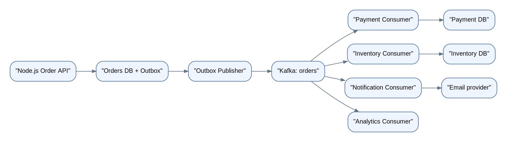

*Editable diagram source: `image/diagram_15.mmd` · Scalable version: `image/diagram_15.svg`*

### Suggested implementation milestones

1.  Create an order API and persist an order.
2.  Add an outbox table/collection in the same transaction as the order.
3.  Publish outbox events to Kafka.
4.  Create payment, inventory, notification, and analytics consumer
    groups.
5.  Use `orderId` as the key.
6.  Add event validation and a DLQ.
7.  Add idempotency to consumers.
8.  Add structured logs and correlation IDs.
9.  Simulate broker/consumer restarts.
10. Document retry policy, retention, replication, and recovery steps.

### Example event contract

``` json
{
  "eventId": "evt-unique-id",
  "eventType": "OrderCreated",
  "eventVersion": 1,
  "occurredAt": "2026-10-20T08:00:00Z",
  "producer": "orders-service",
  "data": {
    "orderId": "order-1001",
    "customerId": "customer-42",
    "total": 1499,
    "currency": "INR"
  }
}
```

Keep event contracts stable, document ownership, and do not include
secrets or unnecessary personal data.

------------------------------------------------------------------------

## 25. Final revision sheet

Remember these 10 rules:

1.  Kafka stores records in **topics**, which are split into
    **partitions**.
2.  Ordering is per partition, not global.
3.  A key helps related events reach the same partition.
4.  A consumer group shares partitions; separate groups independently
    read the same topic.
5.  Offsets track each group's progress.
6.  Replays and retries mean duplicate-safe processing is essential.
7.  Replication protects data; consumers provide processing capacity.
8.  Retention controls how long data is kept; compaction preserves
    latest values per key.
9.  Exactly-once Kafka processing does not automatically cover external
    APIs or databases.
10. For database + Kafka consistency, learn the **transactional
    outbox**, then add idempotent consumers.

## Official resources

-   Apache Kafka documentation: https://kafka.apache.org/documentation/
-   Apache Kafka quickstart: https://kafka.apache.org/quickstart/
-   KafkaJS documentation: https://kafka.js.org/
-   Kafka design documentation:
    https://kafka.apache.org/documentation/#design

------------------------------------------------------------------------

**Suggested study routine (1 hour per day):** - 10 min: Review
yesterday's concepts. - 20 min: Read one section and redraw its diagram
from memory. - 20 min: Run or modify the code. - 10 min: Answer two
interview questions and record what you learned.
